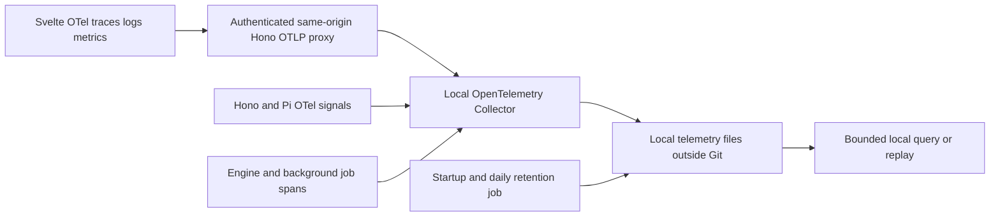

# ChessLasso architectural notes

These decisions supplement the [PRD](PRD.md). Version 0.2 implements the durable training path described below, retaining deterministic mock mode. Automated code development/deployment remains pending an independently isolated runner and verified external release adapter.

## Move-scoped interaction

The backend owns legal chess state. Each accepted player turn, including the opponent's response, creates a conversation section identified by activity, board, move IDs and immutable position version. Instructions and follow-up messages belong to that position. Prior discussion is never reassigned when the board changes. SQLite persists position FEN, canonical move context and full conversations. SSE notifies connected views to restore the authoritative snapshot; command IDs deduplicate retries and expected versions reject stale mutations. A short renewable control lease permits explicit device takeover.

Advance the feed to each new message after accepted moves or follow-up chat, showing the beginning of long replies. Rejects and failed submissions preserve the current section. Observation mode advances the position without emitting hints. Preserve keyboard focus while scrolling; honor reduced motion and reveal the coaching section on mobile. Out-of-order or repeated events must not create duplicate sections or attach a reply to the wrong position.

The browser can review any recorded ply without undoing the authoritative game. A compact SAN button list beneath the board highlights the displayed position, with start/previous/next/latest controls and a bounded scrolling area for long games. Returning to the latest position restores move entry. A historical chat request supplies only a ply index; the server reconstructs its FEN and PGN from the current game and restricts coaching to read/analysis tools. Review exposure is recorded separately from live-position exposure.

Game completion calls the coach even during observation. The coach receives the completed game and current training plan and must use `choose_next_activity` to select a review, another assessment game or focused practice, citing an exact plan excerpt. The host validates and records the decision against the game version, planning turn and plan hash, and renders its explanation. Review normally comes first and selects a historical ply without replacing the completed game. An assessment continuation explains what the next independent game measures and requires a standard starting position with quiet coaching. A board replacement without a same-turn plan-backed decision is rejected. A failed planning turn preserves the result and completed archive rather than silently choosing or starting a game.

The coach supplies a task heading and subtitle as activity data, independently of whether it also replaces the board. There are no player-facing New game, opponent identity or individual PGN download controls. PGN recording remains automatic in the production archive. The move row contains an accessible input, play icon and notation icon; validation guidance appears only when needed.

## Runtime and credentials

Use Svelte, Hono/Node, the native TypeScript 7 compiler, Vite and Oxc with plain modern CSS. Embed the restricted Pi host and supervise Stockfish over UCI. Keep operational state in local SQLite and export the human-readable coaching records into their separate private repository.

`GEMINI_API_KEY` is available in the operator's local `.env` for the implementation phase after prototyping. Do not read it into the frontend, prefix it with `VITE_`, embed it in configuration/history, print it, or copy it to any repository. Load it only in the server's live-provider setup. Mock mode stays deterministic even when the key exists; live mode must be an explicit runtime choice. Validate real tool calling with a minimal server-side smoke check after integrating Pi.

## Local OpenTelemetry pipeline

Use `chesslasso.web`, `chesslasso.server` and `chesslasso.worker` resource identities, with app release, environment and SDK/schema versions. Initialize Node instrumentation before application imports and browser instrumentation before mounting Svelte. Propagate W3C `traceparent`/`tracestate` only to the app's same origin and explicitly approved downstream services. Restrict browser OTLP ingestion by the app's existing authentication, Origin checks, payload limits and rate limits; never expose the collector as a public unauthenticated receiver.

The implemented single-user collector runs in-process behind authenticated Hono ingestion. Official OpenTelemetry SDK exporters normalize traces, logs and metrics into allowlisted JSONL records, avoiding a separate collector binary. This is a deliberate implementation simplification from the originally proposed loopback Collector/file exporters. Records retain W3C trace/span relationships, bounded attributes and trusted receipt timestamps. A standard OTLP Collector can replace the transport/store later without changing the 90-day contract. The original external-collector option would use separate file exporters for traces, logs and metrics in newline-delimited OTLP JSON. This single-user storage choice avoids needing a hosted observability account. Collector files support all three signals but the exporter is alpha; pin versions, verify replay, and keep the transport/storage configuration replaceable. Rotated-file `max_days` applies only to rotated files and does not itself trigger rotation. Therefore it is insufficient as the complete retention policy. [Collector file exporter](https://github.com/open-telemetry/opentelemetry-collector-contrib/tree/main/exporter/fileexporter)

Keep telemetry under an operator-configured local directory outside the source checkout and coaching repository, such as a sibling `chesslasso-runtime/telemetry`. Use restricted filesystem permissions. Source configuration may be public; telemetry data and exporter credentials may not. A later local indexed backend can replace the file exporters if query volume requires it; all three signals and the retention contract stay the same.

### Signals

| Surface             | Traces                                                                               | Structured logs                                                          | Metrics                                                                     |
| ------------------- | ------------------------------------------------------------------------------------ | ------------------------------------------------------------------------ | --------------------------------------------------------------------------- |
| Browser             | Load, move submit-to-accept, position render, instruction reveal, chat and reconnect | Redacted validation/error/reconnect events                               | Move/notation failures, request and render latency, connection transitions  |
| Hono                | Request, command validation, SQLite/outbox, SSE delivery and OTLP forwarding         | Validation categories and bounded error context linked to trace/span IDs | Request errors/latency, command backlog, connected clients, telemetry drops |
| Coach and Stockfish | Pi turn/tool/provider request; engine searches and cancellation                      | Tool outcome, retry and failure metadata                                 | Tool/engine latency, usage/cost estimates, error counts                     |
| Background jobs     | Consolidation/critique, archive commit/push, development and rollout                 | Stage transitions and rollback outcomes                                  | Job duration/failures, backlog age, backup freshness and storage size       |

Do not use player/game/position IDs, SAN, FEN or arbitrary error text as metric dimensions. Those would cause unbounded cardinality. Traces/logs may carry bounded opaque correlation IDs that link to authorized archive records. They must not copy conversation bodies, prompts, PGNs, model responses, environment variables, secrets or authorization headers. Strip URL query strings and sanitize exception messages before SDK/exporter processing; a server-only redaction pass cannot undo a secret already exported by the browser.

Browser instrumentation is experimental and OpenTelemetry JS logs are currently marked in development. Verify traces, logs and metrics explicitly on both sides against a compatible pinned dependency set; do not equate installing a tracing SDK with delivering all three signals. [OpenTelemetry JavaScript status](https://opentelemetry.io/docs/languages/js/)

### Retention and recovery

- Retain each operational telemetry record for a rolling 90 days from trusted server receipt, using UTC instants rather than calendar-day or browser-clock assumptions.
- Run expiry on startup/wake and daily, including periods with no new traffic. Partition or safely rotate/compact active data so low-volume files do not retain expired records forever. Filter expired data at query time, too.
- Apply the limit to traces, log records, metric points, indexes, rotated files, staging/export queues and local telemetry copies. Do not put raw telemetry in either Git repository or their backups, where ordinary file deletion would leave historical copies.
- Preserve the last 90 days under normal operation. Do not let a default file-count limit silently discard recent history. Bound memory/queue/disk use, expose collector health, and report dropped diagnostics if storage is exhausted.
- Telemetry emission is best-effort and cannot block accepted moves, engine responses or archive writes. Bound retries and avoid recursive self-instrumentation of the OTLP proxy. Flush exporters during graceful shutdown with a deadline.
- Test the exact cutoff with an injected clock, late batches, an idle collector, restart, a failed cleanup, full disk, denied writes and collector outage. Test context continuity from browser move through server, agent/tool and response, plus secret redaction and metric dimension bounds.

The 90-day expiry governs operational observability. Native Pi JSONL sessions, full prompt versions, PGNs, profile, diary and training events are the durable coaching record and retain their existing policy. Link diagnostics to those records by ID without duplicating private content. A retention cleanup must be unable to traverse into the coaching archive.

## Implementation handoff

Finish production foundation before enabling automatic deployment: authoritative/recoverable chess state, Stockfish, restricted Pi tools, configurable prompts, archive/search, presence, runtime budgets, local OpenTelemetry and private backup. Then add the daily independent coaching meeting and isolated Codex development/rollback pipeline from the PRD. Retain mock mode, synthetic browser scenarios and screenshot capture throughout.

## Implemented runtime and remaining limits

`server/index.ts` initializes local telemetry before dynamically importing the application. `Store` owns SQLite transactions and the human-readable private archive. `Runtime` serializes foreground commands, validates every SAN/FEN, invokes bounded Stockfish workers and dispatches restricted Pi tools. Pi discovers no shell/filesystem builtins, extensions, AGENTS files or external prompts. The supplied provider key stays in an in-memory credential store. Effective prompts/tool manifests and native session trees are archived with credential redaction before persistence.

Stockfish receives full PGN history to preserve repetition context. Coach-assigned moves cannot play the player's side. Separate demonstrations validate every complete SAN continuation before display and may begin at a custom FEN. Read-only QuickJS snapshots have2-second/64 MB limits and no Node, filesystem, network or process handles. Main-state mutation versions remain host checks, independent of prompt text.

Daily roles stage record/prompt/backlog changes; only the final independently accepted proposal applies them. All requested traces/logs/metrics use real SDKs; the local JSONL store is normalized rather than a full OTLP replay backend. The24/7 supervisor lifecycle, isolated Codex runner, active-use rollout and rollback adapter are **not operationally enabled or verified**. Docker is installed but its daemon is stopped. The app records pending development work instead of running a host agent with private-data access. Fireworks, real phones, long-duration operation and long-duration daily operation have not been tested. Training games are currently untimed; imported PGNs retain supplied time controls.
