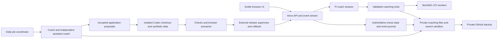

# ChessLasso product requirements and implementation design

Status: approved design plus usable version 0.2 implementation. The real Pi/Gemini/Stockfish training path, durable private archive, daily scheduler and local observability are implemented and tested as described in docs/VALIDATION.md. Isolated Codex execution and automatic release/rollback remain pending external runner setup; other operational limits are recorded there. Requirements below remain the target acceptance contract, not a claim that every scenario has been operationally verified.

## 1. Purpose and success

ChessLasso is a personal chess coach for a beginner. It should develop a well-rounded player through purposeful practice, conversation, games, reflection, and repeated tests of independent understanding. The initial ambition of reaching 1800 becomes a long-term reference rather than the objective the system optimizes at the expense of enjoyment or broad skill.

FIDE standard is the reference rating system. Most available results will come from Chess.com and must retain their source, rating pool, time control, date, and assistance provenance. There is no fixed conversion from those results, Stockfish accuracy, or bot difficulty to a FIDE rating. The coach may give a clearly labelled provisional strength assessment with evidence and uncertainty; it must say when a numerical estimate cannot be justified. Actual FIDE-rated games are the eventual validation of a FIDE rating.

The coach establishes a baseline through varied play and questions, then negotiates training commitment with the player over time. No fixed daily quota or completion deadline is imposed. A useful outcome is retained, independent performance in unfamiliar positions and games, with a training routine the player wants to continue.

The first release serves one player, locally, through a desktop/mobile browser exposed using Tailscale. It does not need multiple accounts, native installers, offline AI, public matchmaking, payments, or a fixed Ted Lasso persona.

## 2. Delivery boundary

| Capability                                                     | Version 0.2 state                                                                                     | Remaining verification or limit                                                                                  |
| -------------------------------------------------------------- | ----------------------------------------------------------------------------------------------------- | ---------------------------------------------------------------------------------------------------------------- |
| Compact Svelte/Hono, keyboard SAN, move-scoped chat and boards | Implemented;12 browser scenarios pass                                                                 | Real phones/screen readers not tested                                                                            |
| Stockfish + Pi coaching                                        | Actual local engine and restricted Pi tools; live Gemini HTTP turn/restart passes                     | Requested3.8 Flash listed but generation timed out; explicit verified3 Flash preview default; Fireworks untested |
| Durable profile, plans, diary, PGNs/index and native logs      | SQLite plus separate private Git archive; first backup pushed; checkpoint recovery tested             | Long-running archive size/restore scale not exercised                                                            |
| Presence and control                                           | Focus/visibility/heartbeat records, unknown gaps, single-device move lease                            | Exposure is not attention; training games currently untimed                                                      |
| Runtime budgets/prompts                                        | Per-model-request reservations, editable modes/provider/model, revision history and undo              | Invoice estimates; external Codex accounting separate                                                            |
| Imports and search                                             | Original/derived PGNs, metadata, dedup/quarantine, Chess.com incremental cursor, bounded QuickJS      | Real account import/throttling not live tested                                                                   |
| Daily independent meeting                                      | Sydney 04:00 durable scheduler, two critique rounds, staged accepted updates, catch-up/retry fixtures | Synthetic full live daily meeting passed; long-duration scheduling untested                                      |
| Local OpenTelemetry                                            | Client/server traces/logs/metrics, W3C context, allowlisted JSONL collector,90-day expiry             | Normalized JSONL rather than full OTLP replay; long-duration disk operation untested                             |
| Nightly Codex/self-deployment                                  | External supervisor candidate pipeline and protected gates; accepted backlog queue                    | **Pending verified isolated runner and release adapter; Docker daemon stopped. No automatic rollout claimed.**   |

Mock mode remains deterministic even when `.env` has a key. Live mode is an explicit persisted runtime choice. Secrets and personal records never belong in the public code repository.

## 3. Learning strategy and evidence

The initial loop is **attempt → reasoning → checked feedback → focused practice → delayed retest → independent transfer**. The coach should adjust it based on observed learning, fatigue, preferences, and the available time. It may choose any exercise or game arrangement expressible through the tools; the application does not impose a closed list of game types.

Coverage includes board vision, elementary tactics, calculation and candidate moves, defensive awareness, opening principles, strategic plans, basic mating patterns and endgames, time management, algebraic notation, and self-analysis. The coach chooses emphasis from evidence rather than prescribing fixed percentages. Opening memorization must not substitute for elementary understanding.

### Evidence and its limits

- [Charness et al., 2005](https://onlinelibrary.wiley.com/doi/abs/10.1002/acp.1106) associates accumulated serious study with chess skill. It is observational and does not prescribe a guaranteed route or timetable to 1800.
- [Roediger and Karpicke, 2006](https://pubmed.ncbi.nlm.nih.gov/16507066/) supports retrieval attempts for delayed retention in a non-chess setting. Applying the mechanism to chess is a design inference to test through later independent attempts.
- [Shute, 2008](https://journals.sagepub.com/doi/10.3102/0034654307313795) supports specific, manageable feedback after an attempt, with timing and explicitness adapted to learner needs. It also warns against interrupting engaged problem solving. This is general educational evidence.
- [ManyClasses, 2021](https://www.psychologicalscience.org/journals/ampps/25152459211027575/) found no general advantage of immediate over delayed feedback across its college classes. The app must not claim there is one universally optimal feedback delay.
- [Sinha and Kapur, 2021](https://journals.sagepub.com/doi/10.3102/00346543211019105) supports carefully designed problem solving followed by instruction for conceptual learning. It does not justify leaving a beginner without prerequisites or feedback indefinitely.
- [Chess Steps teaching guidance](https://www.stappenmethode.nl/en/info/workbooks) combines instruction, exercises, games and discussion. Mixed positions test recognition beyond exercises labelled with the target motif. This is established pedagogy, distinct from controlled evidence for this app.
- [Lichess accuracy documentation](https://lichess.org/page/accuracy) explains how complexity and game context affect engine-based accuracy. Neither accuracy nor mean centipawn loss establishes a calibrated human rating.

Maintain a private, cited research register with source, date accessed, claim, evidence type, limitations, and the training decision it informs. New research is proposed in the daily meeting and evaluated against observed outcomes. The coach should distinguish a sourced finding from its own application of that finding.

### Adaptive intervention policy

These are initial, revisable teaching hypotheses, not fixed thresholds:

| Observable situation                                                            | Initial coach response                                                                               |
| ------------------------------------------------------------------------------- | ---------------------------------------------------------------------------------------------------- |
| Player compares plausible candidates or explains a line                         | Let the attempt develop; do not interrupt merely because the engine sees a stronger move             |
| First error on a familiar idea                                                  | Usually let the player commit, then ask one specific question or review the consequence              |
| Cognitive cause is unclear                                                      | Ask about the intended plan, perceived threat, or expected reply; a board may accompany the question |
| Player requests help                                                            | Offer the smallest useful cue, then more explicit instruction if needed                              |
| Missing prerequisite, repeated unsuccessful reasoning, or expressed frustration | Give direct explanation or a short worked example; simplify the task if useful                       |
| Notation or interface error                                                     | Explain immediately without treating it as a tactical failure                                        |
| A useful full-game flow                                                         | Queue feedback unless the current teaching purpose warrants interruption                             |
| Assisted success                                                                | Schedule a later, different, unlabelled independent attempt                                          |

The coach decides whether to intervene immediately, offer assistance first, or wait. It records its reason and respects feedback such as “let me think” or “less interruption.” Silence, connection status, or mouse inactivity alone cannot establish confusion or attention. No universal timer or engine-loss threshold forces a hint.

Record assistance before/after move commitment, original attempt, displayed text/arrows/variation, affected position, reason, and timing. Merely offering a targeted hint can convey information and is itself an event. Interpretation changes from the point of assistance; earlier independent decisions remain usable evidence. The app must not silently relabel the whole game as unassisted later.

## 4. Main experience

### Practice room

Desktop uses a large board and move entry on the left, with a position-scoped coach feed on the right. Use a compact, dense application layout. The coach controls a task-specific heading and subtitle at the top; these are dynamic exercise content, not promotional copy. Remove opponent/“Practice partner” metadata, manual New game controls, and individual-game download buttons. The coach initiates and replaces training activities through tools. Put canonical move context in the coach feed rather than duplicating it around move entry. Mobile stacks board, move entry, and chat; entering a move must not require scrolling past the conversation. Navigation offers practice, progress, and journal, with preferences in a small settings dialog.

Make turn/game status and assistance provenance accessible through the board/feed without adding routine explanatory copy around move entry. Do not show engine evaluations or best-move arrows automatically while testing independent judgment. The coach can show selected analysis when pedagogically useful, recording that exposure.

The coach can set a full game, choose the player's side, replace the board with a validated custom position, assign either side to an opponent, pause or stop an exercise, and present a new task. A replacement archives the old position and continuation before switching. The activity tool also supplies or revises the task heading and subtitle; it can update this metadata without replacing the board. A running game survives refresh, disconnect, a daily boundary, and an application upgrade.

### Keyboard move entry and notation teaching

Player moves require keyboard submission on every board where an answer is played. Disable click-to-move, dragging and premoves. A mobile software keyboard is supported. Selecting text, inspecting a square, or flipping a board must never submit a move.

Teach short algebraic notation: `e4`, `Nf3`, `Bxe6`, `Nbd2`, `O-O`, `O-O-O`, `e8=Q`. Accept zero-based castling aliases and omitted check/checkmate suffixes. If a suffix is supplied, it must be correct. Record/display canonical SAN. Reject coordinate-only entries such as `e2e4` as outside the chosen teaching format, even though FIDE also permits longer algebraic forms. These are application teaching rules, not a claim that FIDE forbids longer notation. See [FIDE Appendix C](https://handbook.fide.com/chapter/e012023).

The move-entry row contains only the input and play/notation icons. Keep accessible names and tooltips, and show an actionable error only when necessary. Do not add visible field titles, notation subtitles, routine success banners, or repeated instructions around the field.

Resolve input against the legal moves from the exact position. Never guess an ambiguous move. Distinguish malformed notation, ambiguity, and illegality; explain the category and the next correction. Preserve the entry, board, turn, and clock policy after rejection. Open a compact notation guide, return focus to the field on dismissal, and make it available on demand. Avoid listing best moves as part of notation recovery.

Keep notation-entry time and rejected attempts separate from tactical decision errors. Promotion requires a named promotion piece. Test castling, captures, disambiguation, checks, checkmate, en passant, underpromotion, pinned pieces and moves that leave the king in check.

### Conversation, notes and demonstrations

Conversation is organized per move/decision position rather than as one undifferentiated AI chat. Each accepted player move and subsequent opponent reply creates a new position-linked conversation section containing canonical moves and the coach’s next instructions. Follow-up discussion stays attached to that section; earlier sections remain available above it. Scroll the feed to the beginning of the new instructions on every accepted move, respecting reduced motion. On mobile, reveal the coach section without losing the move-entry focus. Rejected moves or disconnected submissions do not create a new section. In an observation period, advance to the new position section without disclosing hints. Persist these associations in production and restore them on reconnect.

The player can discuss the current position at any time, explain a plan, request instruction, or give coaching/application feedback. Bind messages to an immutable position version so the coach does not answer a different position after a concurrent move.

The coach can write an unobtrusive note tied to a move or position while the player continues. Notes do not seize focus or cover the board. A deliberate lesson may open a modal with its own board, title, annotated steps, arrows and variations. Previous/next and direct step controls support keyboard operation. Closing it restores the original game and focus.

Questions can include their own board and validated keyboard answer. Board IDs and position versions distinguish main play, demonstration, and question boards. The player can explore a question without accidentally moving the main game's pieces.

### Progress and journal

The profile contains strengths, candidate weaknesses, confidence/evidence counts, notation competence, preferences, engagement constraints, baseline observations, and pending retests. Avoid a single opaque “skill score.” Show what was observed and what remains uncertain.

The journal records daily observations, assistant-coach challenges, decisions, plans, references to exact game positions, prompt changes, and application proposals. The player can inspect and correct personal facts or preferences. Corrections create history rather than erasing the original record.

### Imports

Support PGN upload/paste and an incremental Chess.com archive import by username. Keep imported ratings and time controls as supplied, validate chess data, deduplicate by stable source ID or normalized game hash, preserve original metadata and comments, and record import time separately from play time. Assistance status is “unknown” unless established. Handle unavailable/private/deleted games, throttling, partial import and retries without losing completed games. Imports do not submit moves to external live games.

## 5. Architecture

Use the latest compatible stable Svelte, Vite, TypeScript compiler, Oxlint and Oxfmt, pinned by the lockfile. Use modern CSS directly: custom properties, cascade layers, grid/flex layouts, responsive range queries, logical properties and reduced-motion support. No styling framework or component suite is required.



The backend is authoritative for position, legal moves, clocks, activity lifecycle, tool authorization and event persistence. A rules library validates every position and move before Stockfish or UI mutation. The browser never decides that a move is accepted solely because a local check passed. See [architectural notes](ARCHITECTURE.md) for the move-scoped feed, server-only secrets, and local OpenTelemetry pipeline.

Use HTTP for commands and an authenticated, reconnectable SSE stream for server events. Events include stable IDs, board/activity IDs, UTC timestamps and monotonically increasing position versions. Commands carry client idempotency keys and expected versions. Stale commands fail with the current snapshot. Reconnection requests events after the last acknowledged ID; missing history falls back to a snapshot. A single writer owns each game's state. Only one device holds the move-control lease; other connected views observe until a deliberate handoff.

A compact SQLite database outside the code repository stores operational state, event outbox, job ledger, import cursors and usage reservations. It is runtime infrastructure, not a replacement for the required human-readable files. Archive exporters produce deterministic PGN/JSONL/Markdown records; indexes can be rebuilt from them. Crash recovery replays committed events and drains the outbox idempotently. No accepted move depends on a later successful Git push.

### En Croissant reuse

[En Croissant](https://github.com/franciscoBSalgueiro/en-croissant) is React/Mantine/Tauri, rather than Svelte. Its board modules integrate with its stores and native backend. Reuse its interaction lessons: orientation, move notation, separate analysis boards, annotations, clocks and position setup. Do not port its entire application shell.

Use its maintained [Chessground dependency](https://github.com/lichess-org/chessground) directly from Svelte, with a small lifecycle wrapper. Chessground renders boards and annotations; it does not validate chess rules. The prototype uses chess.js for legal move generation and PGNs; use the same rules authority in production unless a concrete unmet need justifies replacement. Publish the combined application under GPL-3.0-or-later, retaining dependency and piece-art notices. Stockfish binary distribution must include the corresponding license and a compliant source offer/source link for that exact build. [Stockfish developer guidance](https://official-stockfish.github.io/docs/stockfish-wiki/Developers.html)

### Stockfish

Run the official binary as a supervised local subprocess speaking UCI, rather than a browser-only engine. Validate FEN, history and limits before writing commands. Send both starting position and complete move history so repetition is represented. Parse readiness, analysis and bestmove events, bound search time/nodes, cancellation and output size, and restart a failed worker. Separate opponent and analysis jobs, with resource limits so background analysis does not stall a live response.

Store engine version, network identifier, options, search limit, depth, MultiPV and score perspective with each analysis. Represent mate scores separately from centipawns. Bound `go` searches rather than using the approximate static `eval` command. Treat UCI text as data. [Stockfish UCI documentation](https://official-stockfish.github.io/docs/stockfish-wiki/UCI-Protocol-and-Stockfish-Commands.html)

The coach may delegate moves to adjustable Stockfish bots or select a move itself through tools. All selected moves must pass the same validation. Reduced-strength Stockfish is not a calibrated beginner human; the UCI Elo option is not a FIDE assessment of the player. A human-like opponent is a future optional provider, not a prerequisite or an extra research project for the first release.

## 6. Pi agent design and tool contract

Embed Pi through its current TypeScript SDK. Pin the package name/version after checking the release actually used: current documentation uses `@earendil-works/pi-coding-agent`; older references use `@mariozechner/pi-coding-agent`. Build a restricted host with an explicit tool list and resource loader, not the unrestricted coding CLI environment. [Pi SDK](https://github.com/earendil-works/pi/blob/main/packages/coding-agent/docs/sdk.md)

Start with Google `gemini-3.8-flash` where available to the configured account. Model/provider settings are runtime configuration, with Fireworks as an alternative supported by Pi. Validate credentials, tools, structured output, latency and actual account model access at setup. Provider changes create a new run configuration version rather than silently rewriting past sessions. Model substitution is explicit; it must not change budgets or grant tools. [Gemini model](https://ai.google.dev/gemini-api/docs/models/gemini-3.8-flash), [Pi AI providers and mocks](https://github.com/earendil-works/pi/blob/main/packages/ai/README.md), [Fireworks tool calling](https://docs.fireworks.ai/guides/function-calling)

| Tool                              | Inputs and effect                                                                                                                       | Required guarantees                                                                    |
| --------------------------------- | --------------------------------------------------------------------------------------------------------------------------------------- | -------------------------------------------------------------------------------------- |
| `inspect_board`                   | Board ID/version; FEN, history and permitted observations                                                                               | Do not expose hidden analysis to the player without recording assistance               |
| `analyse_position`                | Board/version, bounded engine limits and variations                                                                                     | Valid position/history, cancellation, engine provenance                                |
| `start_activity`                  | Position or full game, player side, opponent assignment, clock parameters, free-form goal, heading/subtitle and assistance instructions | Archive prior activity, validate setup, no arbitrary executable exercise code          |
| `play_move`                       | Board/version and SAN or validated UCI from a bot                                                                                       | Correct side/lease, legality and idempotency; SAN remains player entry format          |
| `set_opponent`                    | Side, supported bot/provider and bounded strength parameters                                                                            | No fabricated rating equivalence; legality validation for every output                 |
| `show_demonstration`              | Initial FEN, ordered moves/branches, text and arrows per step                                                                           | Validate the whole sequence before publishing; separate board and stable IDs           |
| `ask_question`                    | Text, optional board, response shape, optional target skill                                                                             | Store answer/attempt and evidence; no unvalidated injected UI code                     |
| `write_player_note`               | Text, position/move, timing and reason                                                                                                  | No focus theft; assistance provenance if it reveals useful information                 |
| `read_history` / `search_history` | Scoped selectors or sandbox script                                                                                                      | Read-only snapshots, bounded result sizes, no secrets or external access               |
| `propose_record_update`           | Profile/diary/index update with evidence references                                                                                     | Valid schema, path allowlist, atomic writes, immutable originals                       |
| `revise_prompt`                   | Configured prompt target, patch, reason, parent version                                                                                 | History and rollback; cannot modify permissions, user priorities or spending authority |
| `propose_app_change`              | Problem, evidence, desired behavior, acceptance check, priority                                                                         | Backlog entry, not direct shell or deployment access                                   |
| `record_intervention`             | Trigger, timing, exposure, rationale and affected position                                                                              | Persist before exposure; cannot erase assistance later                                 |

Game/exercise descriptions are flexible runtime data, while the underlying tools are typed, validated capabilities. The coach cannot generate arbitrary browser JavaScript or invent a new privileged tool by putting instructions in a task description.

The production host subscribes to Pi message/tool/run events, streams permitted events to the client, and serializes turns. Incoming player messages during a running response use explicit steering/follow-up semantics. Cancel obsolete engine requests. Reject stale tool mutations when a newer move has changed the position.

## 7. Memory, PGNs, search and logs

The public code checkout and private coaching repository are sibling directories with distinct credentials and write boundaries. Never put private data under a served frontend directory or rely on `.gitignore` alone as the separation. Use an explicit private-data path in local configuration.

```text
ChessLasso/                         public application source
chesslasso-coaching/                separate private Git repository
  profile.md
  preferences.md
  research/index.md
  diary/2026/11/2026-11-01.md
  plans/current.md
  plans/history/<plan-id>.md
  games/2026/11/<utc-time>-<game-id>.pgn
  games/index.jsonl
  games/index.md
  events/2026/11/<activity-id>.jsonl
  sessions/2026/11/<pi-session-id>.jsonl
  meetings/<coaching-day>/proposal.md
  meetings/<coaching-day>/critique.jsonl
  meetings/<coaching-day>/decision.md
  prompts/history/<version-id>/...
  prompts/effective/<run-id>.json
  backlog/app-improvements.md
  releases/<release-id>.json
```

Games have stable IDs, UTC start/end timestamps, source IDs, initial FEN/setup tags for custom starts, result, opponents, time controls and source ratings. Preserve mainline and variations, standard PGN comments and annotation glyphs. Keep engine evaluations and coaching notes with the exact ply/position. Mark timestamps using UTC date/time tags and event records; local display time is separate. A game spanning days keeps one identity and PGN, with references from each day's diary.

Keep the original imported PGN unchanged alongside a derived annotated version, or preserve its exact bytes in an immutable source record. Malformed or partial imports go into a quarantine record with a visible error; never silently repair a move sequence and claim it was played.

`index.jsonl` is machine-readable, versioned and rebuildable. It stores game ID, relative PGN path/hash, played/imported times, source/time control, summary, themes, outcome, assistance intervals and evidence references. `index.md` provides a readable browse view controlled by the coach through validated updates. A reference identifies game, ply/position, source event and analysis version, rather than just a filename.

### JavaScript search sandbox

Let the coach run bounded JavaScript over read-only archive snapshots to filter games, group events, calculate descriptive statistics and locate transcripts. Use an isolated worker process with a sandbox engine such as QuickJS, a fixed API for supplied JSON/text, a 2-second initial CPU/time limit, a 64 MB initial memory limit and a bounded result payload. Limits are operator configuration. No host Node imports, network, shell, environment variables, credentials, filesystem writes, or access outside the provided snapshot. Node `vm` alone is not a security boundary. Kill and replace workers that exceed limits.

Search results can propose a profile/index change through a separate validated tool. Treat imported PGN comments, logs and web pages as untrusted data, never as tool permissions or instructions.

### Native session history

Persist Pi's native JSONL session tree rather than flattening it to chat text. Retain IDs, parent relationships, timestamps, user/assistant messages, tool arguments/results, model usage, errors and retry records available through the SDK. Use supported SessionManager APIs for recall and branching. Curated diary/profile files summarize; they do not replace the underlying session record. [Pi session format](https://github.com/earendil-works/pi/blob/main/packages/coding-agent/docs/session-format.md)

Capture effective prompt, model/provider settings, tool manifest, app release, engine version and private-data commit for each run. Store accessible provider diagnostics, not an invented hidden chain of thought. Redact credentials and authorization headers before logging; secrets never enter prompt-history snapshots, public artifacts or Git commits. Full prompt history and native Pi session logs remain part of the durable coaching archive. OpenTelemetry operational traces/logs/metrics are a separate local store with the 90-day retention policy below; they must not duplicate transcripts or prompt bodies. Chunk by day/session so the repository remains inspectable, and surface growth rather than silently deleting history.

### OpenTelemetry observability

Instrument both Svelte/browser and Hono/Node with OpenTelemetry traces, structured logs and metrics. This is required in production implementation, not activated by adding a model key to the prototype. Initialize server instrumentation before importing the application and browser instrumentation before mounting Svelte. Link browser requests to server/tool spans with W3C trace context. Record move validation/acceptance, coach requests and tools, Stockfish work, reconnects, consolidation, Git operations and release jobs. Add latency/error/usage/queue metrics without high-cardinality player/game IDs as metric labels.

Route browser OTLP/HTTP through authenticated same-origin Hono ingestion to a loopback OpenTelemetry Collector. Server and background workers export to the same local collector. Store all three signals locally outside both Git repositories; no cloud telemetry exporter is enabled by default. The initial single-user backend may use Collector OTLP JSON files with bounded rotation and a query/replay path. This is an implementation choice, not an OpenTelemetry storage requirement. See [collector deployment guidance](https://opentelemetry.io/docs/collector/deploy/agent/).

Retain operational telemetry for a rolling **90 days**. Cleanup runs daily and at startup/wake, covers active/rotated files, indexes and staging/queue copies, and removes expired records even when little traffic caused no size rotation. Apply expiration at query time too. Use trusted server receipt timestamps for retention; client clocks cannot extend it. No rotated-file count limit may silently shorten the intended retention. A full-disk condition must surface dropped diagnostics without preventing moves or deleting coaching records. Verify expiry with an injected clock across the cutoff, restart and idle-collector scenarios.

Never export the Gemini key, credentials, authorization headers, URL query secrets, request/response bodies containing chat, full prompts, or raw PGNs into operational telemetry. Allowlist attributes and sanitize errors before emission on client and server. Correlate with opaque run/activity references stored in the durable archive. Telemetry storage is excluded from public/private Git backups so expiration does not leave permanent Git copies. Pi session files, diary, PGNs, prompt history and learning events remain governed by the coaching archive policy, not this diagnostic TTL.

Pin and integration-test the SDK/exporter/collector combination: OpenTelemetry JS currently marks browser instrumentation experimental and logs in development. All three signals remain required; capability verification must not silently omit browser logs or metrics. [OpenTelemetry JS status](https://opentelemetry.io/docs/languages/js/)

## 8. Prompt configuration and adaptation

All natural-language agent instructions live in configurable files: coach role, teaching policy, assistant coach, daily consolidation, application planner, Codex task template, retrospective, and memory rules. Application code assembles versions; it does not hide additional behavioral prompts in route handlers.

Public defaults ship in `config/prompts/`. Private user-specific overrides and their complete history live in the coaching repository. Each revision records parent version, text/hash, author, timestamp, reason, evidence and rollback target. The complete effective prompt can be reconstructed for every agent turn. Compaction summaries and resource-loader transformations receive version/provenance records too.

The player can provide feedback naturally in chat. The coach may immediately change teaching style, lesson strategy and its permitted prompts, on its own initiative or in response to feedback. Apply an atomic revision at the next agent turn; do not mutate instructions underneath an in-flight response. Record what changed and why, and offer undo. Explicit user preferences outrank the coach's self-written guidance.

Permissions, credentials, data-deletion rules, deployment protections and spending authority are application controls, not mutable prompt text. A prompt revision cannot expand them.

## 9. Presence and outcome analysis

Track browser visibility, window focus, connection events, server heartbeats/acknowledgements, explicit pause/resume, active board ID, position version, move display/entry/submission/acceptance and assistance exposure. Use monotonic client intervals plus server timestamps, session sequence numbers and clock-offset estimates. Record network/engine latency independently.

Observed decision time excludes known absence and explicit pauses, with a separate unknown duration during connection gaps or suspension. Do not count overlapping devices twice. A stale heartbeat closes the known interval and starts uncertainty rather than assuming uninterrupted thought. A foreground tab may be unattended; a quiet player may be thinking deeply. Label this as observed exposure/decision time, not measured attention.

Do not log every keystroke. Entry start and submission timestamps, accepted SAN and rejected notation attempts are sufficient for notation friction. Offer a pause button in production and explain what the telemetry measures.

The coach should begin with transparent descriptive analysis: recurring motifs, missed opportunities per comparable opportunity, independent first-attempt success, assistance required, repeated error contexts, delayed retention, transfer to unfamiliar positions, and workload/engagement observations. Include sample counts, denominator definitions, time controls, assistance and engine version. Keep observations and hypothesized causes separate.

Compare like contexts and use game/session as the unit when estimating uncertainty, since moves in a game are not independent samples. Position difficulty, fatigue, opening familiarity and time pressure may confound comparisons. More time and worse moves in difficult positions do not establish that longer thinking caused worse play. A small personal sample cannot justify precise causal claims or population rating calibration.

Daily changes are often observations rather than statistically meaningful trends. Review progress over weeks and keep “insufficient evidence; continue the plan” available. When choosing between interventions, predefine the outcome and use delayed, unassisted tests where practical; do not optimize the metric after seeing the result.

## 10. Daily lifecycle and independent critique

A coaching day runs from 04:00 to 04:00 in `Australia/Sydney`, configurable. Use timezone-aware calendar scheduling, including daylight-saving changes. The game is independent of the day boundary. At cutoff, freeze the day's event watermark; later arrivals are reconciled without losing the activity or being counted twice.

1. Acquire a durable job lease keyed by coaching day and stage. Recover any incomplete prior stage before starting another copy.
2. Flush the archive outbox and snapshot the relevant events, PGNs, prompt versions and commit IDs.
3. The coach proposes observations, strength/weakness hypotheses, evidence/counterexamples, a follow-up plan, prompt revisions and application needs.
4. An independent assistant coach receives the evidence and proposal in its own Pi session, without inheriting the coach's private conversational framing. A distinct prompt is required; a different configurable model is useful but not mandatory.
5. The assistant challenges unsupported conclusions, assistance contamination, small samples, alternative causes, weak teaching choices and unnecessary software changes. It can reject a conclusion or proposal pending revision.
6. Allow at most two critique/revision rounds. Record unresolved disagreements. Retain the previous training strategy when evidence is insufficient; ask the player about consequential unresolved choices on their next visit.
7. Write the meeting transcript, decision, diary, plan and justified prompt/profile revisions atomically. No activity is required to produce a new weakness or feature on an inactive day.
8. Commit and queue private backup. Hand accepted software proposals to the nightly development run.

If the host is asleep, run missed consolidation after wake in chronological, idempotent stages. Do not claim a scheduled run occurred while the machine was off. Normal training may continue against a snapshot; conflicting state changes apply at a safe next-turn checkpoint. Never stop active play to run the meeting or restart the app.

## 11. Nightly application improvement

The coach and assistant maintain an evidence-linked backlog: problem, player/coach impact, reproducer, desired behavior, acceptance check, priority, dependencies, and whether the change requires user approval. The coding agent can add retrospective findings to that same backlog. Do not require nightly code churn; a run may document that no justified change is ready.

Run the installed Codex CLI under a supervisor in an isolated Git worktree. Supply the accepted backlog, code instructions, test scenarios and selected diagnostic excerpts. It normally sees synthetic data, not the private archive or its push credentials. If a specific personal case is needed, provide only the relevant approved evidence through a bounded export.

The run implements a small, complete proposal, runs lint/format/type/tests/build, starts the app against isolated test data and deterministic AI, exercises the relevant browser flows, and captures desktop/mobile screenshots. It must compare tool contracts and database/archive compatibility. New substantial logic gets a targeted test. Failed checks produce a recorded result and preserve the current release.

Its retrospective records what failed, what was learned, repeated friction, possible instruction/tool changes and follow-up tasks. This supplies the requested `/retro`-like behavior without depending on an unavailable named skill. Prompt/instruction changes get the same version history and permission limits as other configuration changes.

Successful changes become a public code commit and a reviewable change record; an automated branch/PR may be used. Automatic deployment is allowed for changes within the established boundaries after checks pass. Credentials/access changes, private-data deletion, permission expansion, budget increases and modifications to the deployment safeguards require user approval and remain pending. Do not weaken checks to make the same run pass.

### Release supervision and rollback

The release supervisor and its deployment policy live outside the application checkout and outside the coding agent's write boundary. The agent cannot rewrite its own acceptance gate. It builds a candidate release directory, validates startup/health and a disposable copy of data, and preserves the last known good release.

Apply only backward-compatible data changes automatically. Destructive or incompatible migrations require approval plus a tested restore path. Wait until no active play/agent mutation is in progress, durably checkpoint current state, atomically switch the active release, restart, then check health and reconnect/recovery. On failure, restore the previous executable release and compatible state. Do not roll back the player's newly accepted moves by blindly restoring an old data snapshot.

The private archive has its own backups. A broken release cannot grant the coding agent access to rewrite it. Keep release ID, source commit, checks, screenshots, prompt/config versions, migration decisions, rollout and rollback results in the release record. Limit each nightly run by an independently configured wall-clock/iteration ceiling to prevent an infinite repair loop; this is separate from the optional spending budget.

## 12. Budgets and runtime preferences

Default to no monthly spending cap. At runtime, the player can select no cap, warning threshold, or hard cap, and change/remove it without restart. Use USD for model-cost accounting and show the period/timezone and estimate status. A player request in chat may change preferences through an explicitly authorized settings action; the coach cannot autonomously raise its own cap.

Warnings notify without selectively deferring background improvements. A hard cap applies to all new paid coaching/background calls. Reserve a conservative bounded call cost atomically before admission; concurrent agents cannot each spend the same remaining amount. Reconcile reservations against actual provider usage and price-version metadata, release failed reservations, and show when billing data is delayed or unavailable. In-flight calls may settle above an estimate; explain that an application cap cannot guarantee an exact provider invoice.

Codex subscription quotas or externally billed usage may not have a directly comparable dollar cost. Track them separately rather than pretending the API ledger covers them. If a complete dollar cap is required, reject unknown-cost paid admission or require an explicit user policy. With no cap, nightly improvements continue. With a hard cap, stopped paid jobs remain visibly pending until the cap changes or the period resets; do not silently discard them.

## 13. Git backup, privacy and access

Create a private GitHub repository for coaching data during production setup and verify its visibility before the first push. The app source can be public under the chosen GPL license. Keep separate remotes and credentials; prevent a configured coaching path from being committed to the public source tree. The user has explicitly authorized publishing this prototype to a new public repository under `nick-boey`. This does not authorize publishing `.env`, private coaching records or telemetry.

Accepted moves/events are persisted immediately. A serialized archive writer batches atomic file updates and regular Git commits: initial defaults every five minutes when dirty, at game completion, and after daily consolidation. The coach can request a checkpoint through the same coordinator. Automatically push after successful commits, with offline retry and a visible last-success state. Commit/push failure never blocks continued local play or removes the pending backup. A divergent remote is reported for resolution; never force-push or reset away coaching history automatically.

Use SSH/credential storage outside either repository. Redact secrets, disallow symlinks/path traversal in archive tools, validate all imported text, bound request sizes and model/tool output, and authorize sensitive routes. Tailscale limits network reachability but does not replace application session validation and CSRF/Origin checks. Use Tailscale Serve HTTPS to a loopback-bound backend, an operator-controlled single-user session/token, exact allowed origins and same-origin cookies. Keep model and GitHub credentials server-side. Do not use Tailscale Funnel or expose the app publicly by default.

The player accepts sending relevant coaching context to the configured model providers and backing up coaching records/transcripts privately. Send selected context rather than the entire archive by default. The coding agent's narrower archive access remains separate from the coach's access.

## 14. Developer workflow and acceptance

The repository must remain runnable without model credentials. `npm ci`, `npm run dev`, `npm run verify`, and the documented Playwright workflow should work from a clean checkout. Pin installed releases in the lockfile and document compatibility exceptions. Latest TypeScript 7 performs checks; Svelte's currently required TypeScript 6 compiler API is installed only as compatibility support using its documented npm-alias setup.

Mock mode exercises the same command/tool validation and UI contracts as live mode. Use deterministic response/tool fixtures, independent mock coach/assistant streams, an injectable clock, temp data roots and fake Git remotes. Pi supplies `fauxProvider`/`fauxToolCall` for production agent-host tests; the prototype's simpler mock HTTP routes demonstrate the UI seam. Never let a development test invoke a real paid provider or write to the private archive by accident.

Minimum production acceptance scenarios:

1. Valid SAN updates once; malformed, ambiguous and illegal entries leave state unchanged and open useful guidance. Clicks/drags cannot play moves. Keyboard and mobile entry both work.
2. The coach starts a full game or custom legal position, delegates either side, receives engine results, makes a legal move, shows a stepped example and asks a board question. Invalid/stale tool output is rejected before mutation.
3. Every accepted move advances the position-scoped conversation and reveals its instructions; follow-ups remain attached to the correct position. Observation mode reveals no unwanted hints. Notes do not steal keyboard focus. Coach tools update task headings/subtitles. No manual New game or individual PGN download controls appear. Separate boards preserve the original game.
4. Reconnect/refresh/device handoff restores the correct board, clocks and event sequence without duplicate moves. Hidden/offline/suspended periods become separate/unknown timing intervals.
5. Completed and interrupted games export/reimport as valid PGN with setup, timestamps, annotations and stable references. Search/index rebuilding agrees with source records.
6. A daily meeting includes independent critique, two-round bounds, evidence-linked decisions and a durable record of disagreements. Inactivity, wake-after-cutoff, duplicate scheduling and crash recovery behave predictably.
7. Coaching prompt changes apply next turn, preserve full history, undo correctly and cannot expand permissions. Logs reconstruct the effective prompt/tool/model context with secrets redacted.
8. Runtime budgets support uncapped, warning and hard-cap modes; concurrent calls cannot bypass a hard cap. Background work is not preferentially deferred. Unknown Codex cost is labelled.
9. Sandbox scripts can search supplied files and calculate summaries; network/filesystem escape, infinite loops, memory exhaustion, excessive output and path traversal fail safely.
10. Private Git commits/push retries work offline and after restart. Wrong/public remotes, secret detection and remote divergence prevent unsafe backup without deleting local work.
11. A Codex candidate can be built, run, mocked and captured with Playwright. Failed checks do not deploy; an unhealthy candidate rolls back; active play postpones restart; accepted moves survive rollout.
12. OpenTelemetry client/server traces, logs and metrics correlate across requests and tool work, survive collector restarts as configured, and expire after 90 days in every storage layer. Collector outage does not block play. Secret/body redaction and metric cardinality limits pass fixture checks.
13. Protected changes await approval. A coding run cannot edit the supervisor, private data or credentials. A retrospective creates useful tasks without forcing a change or rewriting history.

Accessibility acceptance includes semantic labels, visible keyboard focus, native dialog focus containment/return, no color-only errors, readable contrast, reduced motion, 320 px minimum layout, touch-sized primary controls and meaningful textual move history. The board's accessible textual equivalent must include position/piece information in production, beyond the prototype's position label.

## 15. Implementation order

| Milestone                | Complete outcome                                                                                                                                                             |
| ------------------------ | ---------------------------------------------------------------------------------------------------------------------------------------------------------------------------- |
| Interaction prototype    | Review board/chat, notation recovery, demonstrations, question board, sample profile/journal and settings; capture desktop/mobile                                            |
| Durable chess workspace  | Authoritative state/events, game recovery, PGNs/imports/index, presence reconciliation, Stockfish UCI, local access controls, local 90-day OpenTelemetry traces/logs/metrics |
| Live coach               | Restricted Pi host, configurable prompts/models, tools, native logs, archive recall/search, runtime budgets                                                                  |
| Evidence-driven training | Baseline exploration, adaptive interventions, delayed retests, descriptive analysis, private Git backup                                                                      |
| Daily coaching meeting   | Durable scheduler, independent critique, diary/plan/prompt updates, application backlog                                                                                      |
| Autonomous development   | Isolated Codex runs, synthetic scenarios/screenshots, retrospective, external deployment supervisor and rollback                                                             |

Do not enable unattended code deployment before recovery, backup, tool permissions, and rollback acceptance checks are complete. No additional product interview is required to start these milestones; account credentials, paths and remotes are deployment configuration to supply when implementing production setup.
